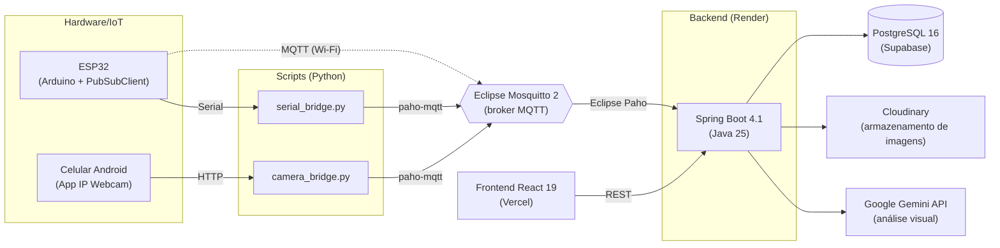

## Sensores para detecção de vazão em rolamentos de trem
> Projeto Integrador.

**Grupo:** André Luiz Rodrigues Fernandes, Edson Abreu de Souza, Gustavo Oliveira dos Santos, Matheus Gamalier

**Curso:** Superior em Análise e Desenvolvimento de Sistemas - Turma CSTADS4
**Professor:** Adriano Alvares

---

## Sobre o Projeto
O Projeto **RailSense** possui como objetivo identificar alterações de dados e imagem, registrar e filtrar sobre possíveis danos causados aos rolamentos de trens de carga.
A implementação da solução Railsense justifica-se pelo alto impacto econômico e ambiental associado à eficiência energética no transporte ferroviário de grande escala. Ao antecipar falhas antes do colapso do rolamento, a solução reduz drasticamente as intervenções corretivas de emergência, maximiza a disponibilidade física dos vagões na EFC e reduz o consumo desnecessário de tração energética. Além disso, a arquitetura modular baseada em microsserviços e serviços na nuvem (Render, Supabase, Vercel) confere ao projeto baixo custo de infraestrutura inicial e alto potencial de replicação em outras malhas ferroviárias nacionais.

## Integrações
| Funcionalidade | Ferramenta |
| :--- | :--- |
| IA para visão computacional | GeminiAPI |
| Serviço em Nuvem | Docker |
| Sensores e câmera | Esp32 e Celular |

## Arquitetura

## Tecnologias

### Backend

| Categoria | Tecnologia |
| :--- | :--- |
| Linguagem | Java 25 |
| Framework | Spring Boot 4.1 (Web MVC, Data JPA, Security, Validation, Actuator) |
| Banco de dados | PostgreSQL 16 (migrations com Flyway) |
| Mensageria | Eclipse Paho MQTT (cliente MQTT em Java) |
| Armazenamento de imagens | Cloudinary SDK |
| Análise visual | Google Gemini (API) |
| Utilitários | Lombok |
| Build | Maven |
| Testes | JUnit / Spring Boot Test |

### Frontend

| Categoria | Tecnologia |
| :--- | :--- |
| Base | React 19 com TypeScript 6 |
| Build | Vite 8 |
| Estilização | Tailwind CSS 4 |
| Componentes | shadcn/ui, Radix UI |
| Ícones | lucide-react |
| Dados | TanStack React Query 5 |
| Rotas | React Router 7 |
| Gráficos | Recharts 3 |
| Notificações | Sonner |
| Tema claro/escuro | next-themes |
| Tipografia | Geist |
| Qualidade de código | ESLint |

### Hardware/IoT

| Categoria | Tecnologia |
| :--- | :--- |
| Microcontrolador | ESP32 (framework Arduino, C++) |
| Build | PlatformIO |
| Cliente MQTT | PubSubClient |
| Broker MQTT | Eclipse Mosquitto 2 |
| Simulação | Wokwi |
| Câmera | App IP Webcam (Android) |

### Scripts

| Script | Bibliotecas | Função |
| :--- | :--- | :--- |
| `serial_bridge.py` | pyserial, paho-mqtt | Ponte entre a porta serial e o broker MQTT |
| `camera_bridge.py` | requests, paho-mqtt, Pillow | Captura das imagens da câmera e envio via MQTT |

### Infra e Deploy

| Categoria | Tecnologia |
| :--- | :--- |
| Containers | Docker e Docker Compose |
| Servidor web | Nginx (serve o **frontend** no container) |
| Backend (produção) | Render |
| Banco de dados (produção) | Supabase (PostgreSQL) |
| Frontend (produção) | Vercel |
